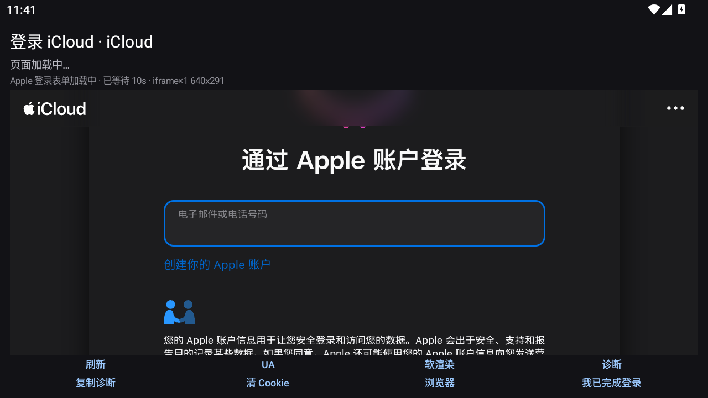
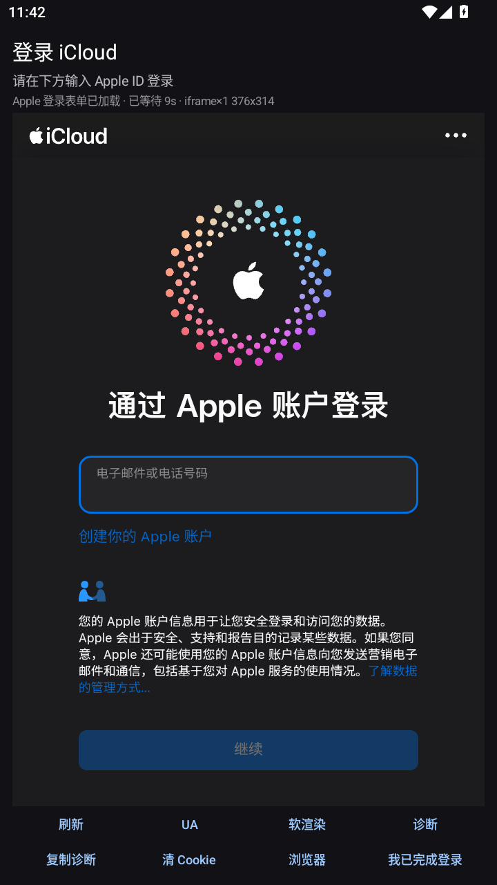
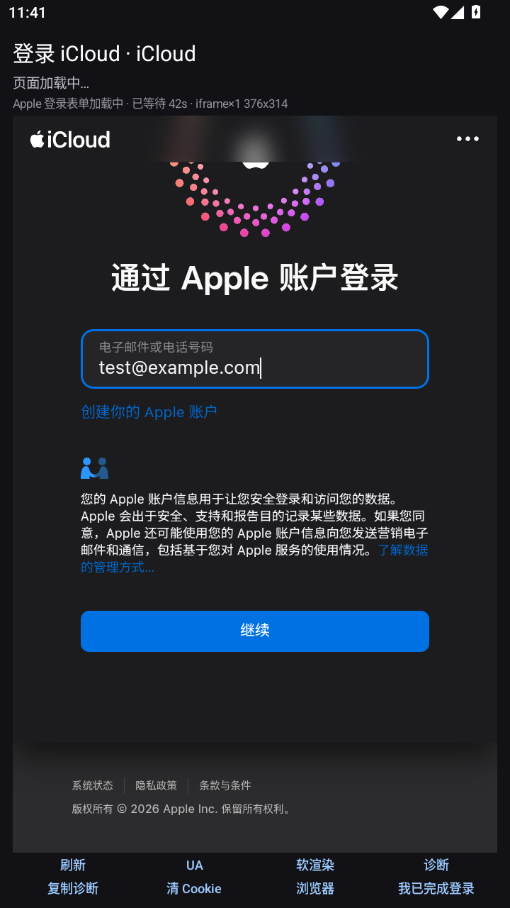

# iCloud 相册 · Android

[](#)
[](#)
[](#)
[](#)
[](#)

一个在 Android 上直接浏览、筛选和下载 **iCloud 照片**的原生客户端。

Web 版 iCloud 相册在手机上每次都要登录、滚动加载慢、还不能批量下载——这个 App 走的是 iCloud 的 Web API（与 iCloud 网页版同源），登录一次后即可用原生界面浏览整个图库，支持年月视图、时间筛选、在线播放视频和保存原片。

> 非官方项目。使用的是 iCloud 网页版的私有接口，Apple 不做兼容性承诺，接口变化可能导致某版本失效。

> 想直接安装：到本仓库的 **Releases** 页面下载 `iCloudAlbum-<版本>-release.apk`（仓库本身不提交 APK 二进制）。

---

## 目录

- [功能](#功能)
- [截图](#截图)
- [快速开始](#快速开始)
- [使用说明](#使用说明)
- [技术架构](#技术架构)
- [iCloud 协议要点](#icloud-协议要点)
- [项目结构](#项目结构)
- [构建与产物](#构建与产物)
- [已知限制](#已知限制)
- [隐私与安全](#隐私与安全)
- [文档](#文档)
- [免责声明](#免责声明)
- [许可证](#许可证)

---

## 功能

| 模块 | 说明 |
| --- | --- |
| **登录** | 内置全屏 WebView 登录 iCloud，自动抓取会话 Cookie；支持**中国区 `icloud.com.cn`** 与全球区 `icloud.com`，区域可一键切换 |
| **浏览** | 自适应列数网格（竖屏约 3 列 / 横屏约 6 列），严格**按拍摄时间由近到远**（新照片在最上面），滚动自动分页，暗色模式自适应 |
| **缩放** | 双指捏合改变网格密度（2~8 列），有 iOS 相册那种"捏一下变密/变疏"的手感 |
| **年视图** | 网格缩到 6 列以上自动切换为年视图：每年一张拼贴封面（1 张大图 + 4 张小图）+ 精确张数；点年份进入该年月视图 |
| **时间筛选** | 「时间」胶囊按**年份 / 年月**筛选，直接定位到那段时间（不用一页页翻），带精确张数 |
| **分类** | 全部 / 照片 / 视频 / 收藏 |
| **查看** | 全屏查看器，左右翻页、双指缩放、双击放大、拖动查看 |
| **视频** | 点播放按钮**在线播放**（ExoPlayer，中码流），也可保存原片 |
| **下载** | 长按网格或查看器右上角保存原图/原片到系统相册（`Pictures/iCloudAlbum`） |
| **性能** | 首页缓存直出（冷启动 ~2 秒）、缩略图按 id 磁盘缓存、时间定位并行采样 |

已针对**上万张照片**的真实图库做过真机测试（Android 15 / 中国区账号）。

## 截图

登录页（其余界面截图涉及真实个人照片，不放入仓库；截图中的账号是占位示例 `test@example.com`）：

| 横屏：Apple 账户登录 | 竖屏：登录表单 | 竖屏：输入中 |
| --- | --- | --- |
|  |  |  |

## 快速开始

### 环境要求

| 组件 | 版本 |
| --- | --- |
| JDK | 17 或 21 |
| Android SDK | Platform 35 / Build-Tools 35.0.0 |
| Gradle | 8.14.x（仓库不带 wrapper，用本机 Gradle 或 Android Studio 自带的） |
| Android 设备 | Android 8.0 (API 26) 及以上 |

### 用 Android Studio

1. `File → Open` 选择项目根目录。
2. 等待 Gradle Sync 完成（首次会下载 AGP / Compose / media3 依赖）。
3. 连接手机（开启 USB 调试）或启动模拟器，点 ▶ Run。
4. 或 `Build → Build Bundle(s)/APK(s) → Build APK(s)`，产物在 `app/build/outputs/apk/debug/app-debug.apk`。

### 用命令行

```bash
# 标准环境（已安装 Gradle / Android SDK）
gradle -p . assembleDebug        # 或 gradle assembleDebug
```

> 仓库不包含 `local.properties`（已在 `.gitignore` 中）。Android Studio 会自动生成；
> 命令行构建时若找不到 SDK，请设置 `ANDROID_HOME` 或自行创建 `local.properties`：
> `sdk.dir=/path/to/Android/Sdk`（Windows 写成 `sdk.dir=C\:\\path\\to\\Sdk`）。

如果机器上 `~/.gradle`、`%TEMP%` 不可写（受限环境 / 离线环境），可以用仓库自带的隔离工具链脚本，它会把 JDK、Gradle、SDK、Gradle 缓存全部重定向到 `.toolchain\`：

```powershell
# Windows
scripts\build.cmd            # 等价于 assembleDebug
scripts\build.cmd -Task lintDebug,assembleDebug
```

详见 [docs/build-env.md](docs/build-env.md)。脚本与本机绝对路径相关，只在本仓库开发机上验证过；正常环境直接用 Android Studio 或 `gradle` 即可。

## 使用说明

1. 首次打开点「打开 iCloud 登录页」，在 App 内登录 Apple ID（需要双重验证时正常输入验证码）。
2. 登录成功后自动回到相册，展示最近的 100 张照片，继续下滑自动加载更多。
3. **双指捏合**缩放网格：缩到 6 列以上变年视图，点年份进入该年月视图；捏回去回到照片网格。
4. 点「**时间**」按年份/年月筛选，选「全部时间」清除筛选。
5. 单击照片进入查看器：左右滑动翻页、双指放大、双击放大；视频点中间播放键在线播放。
6. 长按网格中的照片（或查看器右上角下载按钮）保存原片到系统相册。
7. 设置页可运行「连接自检」排查网络/会话问题，也可退出登录。

## 技术架构

```
 Compose UI                    ViewModel                 Repository / API
 ─────────────────────────────────────────────────────────────────────────────
 GalleryScreen        ─┐
 PhotoViewerScreen    ─┼──►  GalleryViewModel  ──►  IcloudPhotoRepository  ──►  IcloudApi
 SettingsScreen       ─┘                                                       ├─ validateSession
 LoginLaunchScreen ──► LoginActivity (原生 WebView)                            ├─ queryPhotos
                                                                               ├─ countInRange
 Coil（缩略图/预览图，按 id 缓存）  ExoPlayer（视频直链）                        ├─ downloadToTempFile
                                                                               └─ refreshOriginalUrl
```

- **UI**：Jetpack Compose（Material 3），单 Activity + 两个原生 Activity（登录 WebView、视频播放器）。
- **数据**：手写轻量 DI（`AppContainer`），`StateFlow` 驱动 UI 状态，`IcloudPhotoRepository` 负责会话、分页、缓存与错误恢复。
- **网络**：OkHttp 直连 iCloud Web API；图片走 Coil（注入 Cookie/Origin/Referer 的 ImageLoader）。
- **登录**：独立原生 Activity 承载 WebView（**不能用 Compose `AndroidView` 包 WebView**，部分机型会出现 JS 正常但画面全白的合成问题）。
- **视频**：media3 ExoPlayer，自定义 `DefaultHttpDataSource` 注入会话 Cookie。
- **性能**：首页/时间窗页面落盘缓存 → 冷启动直接出图；日期→rank 边界持久化缓存 → 二次跳转秒开。

## iCloud 协议要点

完整协议说明见 [docs/icloud-protocol.md](docs/icloud-protocol.md)，这里只列关键结论：

| 步骤 | 接口 / 说明 |
| --- | --- |
| 登录 | 打开 `https://www.icloud.com.cn/photos/`（或 `.com`），WebView 登录后从 CookieManager 取 `.icloud.com[.cn]` 域的 Cookie（`X-APPLE-WEBAUTH-USER` 等） |
| 会话校验 | `POST https://setup.icloud.com[.cn]/setup/ws/1/validate`，body 为 JSON 字面量 `null`，靠 Cookie 认证；返回 `dsid` 与 `webservices.ckdatabasews.url` |
| 查询照片 | `POST {ck}/database/1/com.apple.photos.cloud/production/private/records/query` |
| 索引 | `recordType = CPLAssetAndMasterByAssetDateWithoutHiddenOrDeleted`，`zoneID = PrimarySync` |
| 排序 | `direction = ASCENDING` + `startRank` 递增 = **由近到远**（`startRank=0` 是最新一张） |
| 视频时长 | `duration` 单位是**毫秒** |
| 资源地址 | `resJPEGThumbRes`（缩略图）/`resJPEGMedRes`（预览）/`resOriginalRes`（原图）/`resVidMedRes`（视频中码流），请求时需带会话 Cookie |
| 智能相册 | ❌ 不可用：任何 `smartAlbum` 值都返回 `400 unknown smart album type`，所以「照片/视频/收藏」在客户端过滤 |
| 时间过滤 | ❌ 不可用：`filterBy` 的 `assetDate` 条件会被服务端**静默忽略**。App 改为"按 rank 定位时间段"：并行采样索引 rank + 页内按日期计数，把日期映射到精确 rank，再从该 rank 分页 |
| 分页陷阱 | 一页按 `resultsLimit=200` 返回"资产 + 主记录"对，边界可能把 CPLAsset/CPLMaster 切到两页；App 会补查缺失 master，避免漏图与数量偏少 |

## 项目结构

```
.
├── app/
│   ├── build.gradle.kts                # 版本号、依赖（Compose / Coil / media3 / OkHttp）
│   └── src/main/
│       ├── AndroidManifest.xml
│       └── java/com/icloudalbum/app/
│           ├── App.kt                   # Application、Coil ImageLoader、AppContainer
│           ├── MainActivity.kt          # 根导航（相册/设置/查看器）、下载权限
│           ├── data/
│           │   ├── IcloudApi.kt         # iCloud Web API：会话校验、查询、时间定位、下载
│           │   ├── IcloudPhotoRepository.kt
│           │   ├── PhotoRepository.kt   # 接口 + MediaFilter / TimeFilter
│           │   ├── PhotoItem.kt         # 照片模型（asset+master 扁平化）
│           │   ├── SessionStore.kt      # 会话与缓存持久化（SharedPreferences）
│           │   ├── GalleryCache.kt      # 首页/时间窗页面磁盘缓存（秒开）
│           │   └── MediaSaver.kt        # 写入系统相册
│           ├── ui/
│           │   ├── gallery/GalleryScreen.kt      # 网格、年视图、时间筛选、吸顶标题
│           │   ├── viewer/PhotoViewerScreen.kt   # 全屏查看器
│           │   ├── login/LoginActivity.kt        # WebView 登录 + 诊断
│           │   ├── player/VideoPlayerActivity.kt # ExoPlayer 播放
│           │   ├── settings/SettingsScreen.kt
│           │   ├── components/UiKit.kt
│           │   └── theme/Theme.kt
│           └── vm/                      # GalleryViewModel / SettingsViewModel / UiState
├── docs/
│   ├── icloud-protocol.md               # iCloud Web API 关键结论（认证/查询/时间定位/已知限制）
│   └── build-env.md                     # 离线/隔离工具链搭建记录
├── scripts/build.ps1, build.cmd         # 一键构建（隔离工具链）
├── CHANGELOG.md                         # 版本变更记录
├── LICENSE                              # MIT
└── README.md
```

## 构建与产物

```bash
gradle assembleDebug     # 调试包
gradle assembleRelease   # release 包（默认用 debug 签名，便于直接侧载）
```

- 产物：`app/build/outputs/apk/debug/app-debug.apk`（release 为 `app-release.apk`，默认用 debug 签名，便于直接侧载）
- 当前版本：`versionCode 18 / versionName 1.0.17`，包名 `com.icloudalbum.app`
- 仓库不包含 APK 产物（`.gitignore` 已忽略 `*.apk`）；分发给他人请用 **GitHub Releases** 附加构建产物（标签建议与 `versionName` 一致，如 `v1.0.17`）。

## 已知限制

- **私有接口**：iCloud Web API 非公开，Apple 侧调整（索引名、字段、风控）都可能让某版本失效。
- **只读**：目前只能浏览/下载，不支持删除、移到相册、收藏写入等操作。
- **会话过期**：iCloud 网页会话会过期（长期不用或 Apple 风控），过期后回到登录页重新登录一次即可，图库数据不受影响。
- **隐藏照片**：使用 `WithoutHiddenOrDeleted` 索引，因此"已隐藏"的照片不会出现在列表中。
- **Live Photo**：只展示/保存静态帧，不含视频段。
- **数量口径**：App 内数量统计的是"索引中 `assetDate` 落在该时间段的资产数"；若你在 iCloud 网页看到不同数字，通常是隐藏照片、共享相册或时间口径差异。
- **网络**：需要设备能访问 `icloud.com`（中国区账号走 `icloud.com.cn`），被墙网络下无法使用。

## 隐私与安全

- 账号 Cookie 与 `dsid` **只保存在本机** App 私有目录（SharedPreferences），不上传任何服务器；App 没有统计/埋点/广告 SDK。
- 网络请求只发往 Apple 的 iCloud 域名（`*.icloud.com` / `*.icloud.com.cn` / `*.apple.com`）。
- 调试版可在 `chrome://inspect` 里检查登录 WebView，日志 tag：`IcloudLoginDiag`（登录诊断）、`IcloudSort`（排序）、`IcloudRank`（时间定位）。
- 卸载 App 会一并清除本机会话与缓存。

## 文档

- [iCloud 协议说明](docs/icloud-protocol.md)：认证流程、CloudKit 查询体、rank 语义、时间定位、资源字段、已知限制
- [构建环境说明](docs/build-env.md)：离线/隔离工具链、镜像源、耗时与限制
- [CHANGELOG](CHANGELOG.md)：逐版本变更记录

## 免责声明

本项目仅供个人学习与自用，与 Apple Inc. 无任何关联，未获得 Apple 授权。使用非官方接口存在账号风控与接口失效的风险，请自行评估；请勿用于商业用途或违反 Apple 服务条款的场景。因使用本项目产生的任何后果由使用者自行承担。

## 许可证

[MIT](LICENSE) © iCloud Album contributors

第三方依赖的许可证见各自仓库：AndroidX/Jetpack Compose、Coil、OkHttp、androidx.media3 均为 Apache-2.0。
